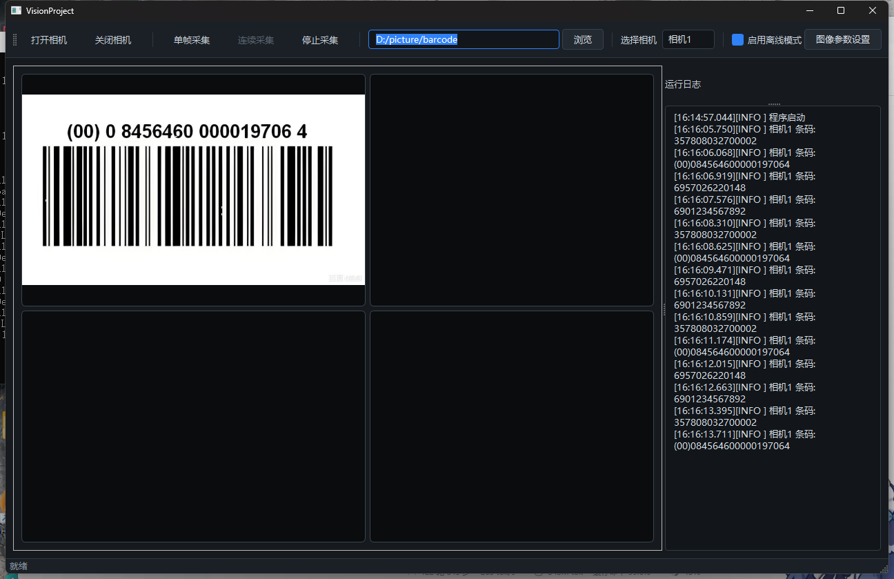
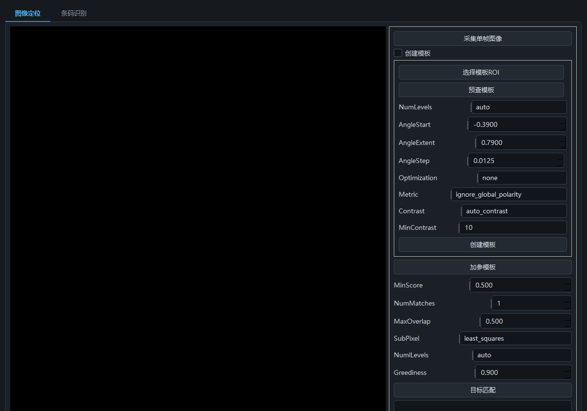
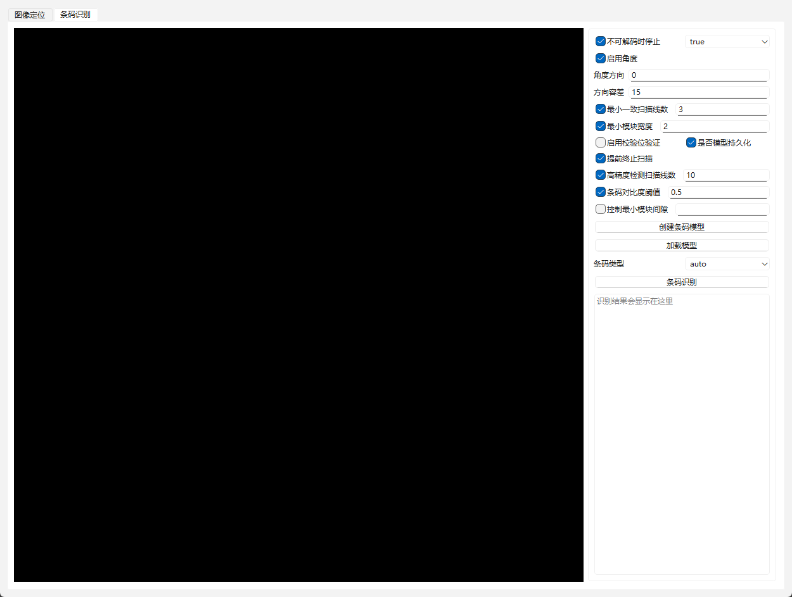

# VisionProject — 工业视觉检测上位机

基于 **Qt6 + Halcon + OpenCV + 海康 MVS** 的桌面视觉软件，实现多相机采集显示、形状模板匹配、一维码识别、参数配置与上位机通信。

> 说明：本项目在课程示例基础上做了**架构重构**（线程模型、日志、设备管理），重点解决跨线程 UI、线程生命周期、采集/显示失配等问题。

---

## 运行截图

**主界面**：四路相机采集与显示，右侧为运行日志（带时间戳与级别）



**参数与算法窗口**：形状模板匹配参数、ROI 交互、条码识别页



**条码识别页**：左侧图像显示，右侧参数与识别结果



> 截图使用离线图片序列模拟采集，未连接真实相机。

---

## 一、功能

| 模块 | 功能 |
|---|---|
| 图像采集 | 4 路相机管理，单帧采集 / 连续采集，支持离线图片序列模拟 |
| 图像显示 | 四宫格实时显示，HALCON 窗口支持 ROI 交互 |
| 形状匹配 | 框选 ROI → 创建模板（可另存多个 .mod）→ 预览 → 目标匹配 |
| 条码识别 | 一维码模型创建/加载，参数可调，识别失败自动旋转 90/180/270 重试 |
| 参数配置 | 参数持久化到 XML，界面与配置双向同步 |
| 上位机通信 | TCP 客户端：登录、心跳、JSON 收发、Base64 图像传输 |
| 日志 | 分级 + 时间戳 + 按天写文件，线程安全 |

---

## 二、技术栈

| 类别 | 选型 |
|---|---|
| 界面 | Qt 6.9 (Widgets)、QSS 深色主题 |
| 视觉算法 | HALCON 17.12（模板匹配、条码）、OpenCV 4.8（图像格式转换） |
| 相机 | 海康 MVS SDK（`MvCameraControl`），离线模式用 `cv::imread` 模拟 |
| 通信 | Winsock2 TCP + nlohmann/json |
| 配置 | tinyxml2 |
| 构建 | Visual Studio 2022 (v143) + Qt VS Tools，x64 Debug |

---

## 三、架构

```
┌──────────────────────────────────────────────────────────┐
│ 界面层  VisionProject（主窗口）  ImageTool（参数/算法窗口） │
└───────────────▲──────────────────────────▲───────────────┘
                │ invokeMethod（排队到主线程）
┌───────────────┴──────────────┐  ┌────────┴───────────────┐
│ 采集/显示工作线程              │  │ 网络线程（收/心跳）      │
│  · 有界队列（容量1，丢旧帧）    │  │  · SocketClient         │
│  · 条件变量唤醒                │  │  · 登录/心跳/JSON        │
│  · 条码识别                    │  └────────────────────────┘
└───────────────▲──────────────┘
                │ pushFrame
┌───────────────┴──────────────────────────────────────────┐
│ 采集层  HK_Camera（MVS / 离线）  DeviceManager（工厂+单例） │
└──────────────────────────────────────────────────────────┘
```

### 数据流

```
相机线程 → pushFrame() → [队列容量1] → 工作线程(条件变量唤醒)
                                        ├─ barCodeIdentify()
                                        └─ postShowImage() → 主线程 setPixmap
```

---

## 四、关键设计决策

### 1. 采集与显示解耦：有界队列 + 主动丢帧
显示只关心"最新画面"，队列容量固定为 1，新帧覆盖旧帧。
**收益**：显示延迟恒定（≤1 帧）、内存恒定；采集速度不受显示速度拖累。

### 2. 条件变量替代 sleep 轮询
工作线程用 `condition_variable::wait_for` 等待，无帧时挂起、来帧即唤醒。
**收益**：零空转 CPU，响应无固定延迟；`wait_for` 的超时仅作退出兜底。

### 3. UI 更新统一回主线程
子线程不直接操作控件，统一 `QMetaObject::invokeMethod(..., Qt::QueuedConnection)` 投递。
**收益**：消除跨线程操作 UI 的未定义行为（这是本项目早期崩溃的根因）。

### 4. 线程生命周期可控
所有工作线程（显示/采集/收数据/心跳）以成员指针持有，退出时先置原子停止标志再 `join`。
心跳的 `Sleep(10s)` 改为 200ms 小步轮询，关闭窗口耗时从 5.2s 降到 0.4s。
socket 的 `recv` 阻塞通过 `closesocket` 打断。

### 5. 日志系统
`Logger` 单例：时间戳 + 级别（INFO/WARN/ERROR）+ 按天写 `logs/`，信号投递到主线程显示。
跨线程写入由 `QMutex` 保护。

### 6. 参数配置
`ImageProcessParam.xml` 保存形状匹配、条码、网络、相机参数，启动加载、关闭回写。

---

## 五、目录结构

```
VisionProject/
├─ VisionProject.sln
└─ VisionProject/
   ├─ main.cpp                入口、主题样式表
   ├─ VisionProject.*         主窗口：采集/显示/通信
   ├─ ImageTool.*             参数窗口：形状匹配、条码识别
   ├─ ImageProcess.*          算法层：Halcon 调用封装
   ├─ HK_Camera.*             相机实现（MVS + 离线）
   ├─ Camera.h / Device.h     设备抽象接口
   ├─ DeviceManager.*         设备工厂 + 单例管理
   ├─ socket_client.*         TCP 客户端
   ├─ Logger.*                日志模块
   ├─ XMlConfigOperator.*     XML 配置读写
   ├─ Task.*                  Base64 编解码
   ├─ ImageProcessParam.xml   参数文件
   ├─ barCodeModel.bar        一维码模型
   └─ shapeModel1.mod         形状模板（示例）
```

---

## 六、编译与运行

### 环境
- Visual Studio 2022（v143 工具集）
- Qt 6.9.3 msvc2022_64 + Qt VS Tools
- OpenCV 4.8.1（`C:\opencv`）
- HALCON 17.12（`D:\halocn`）
- 海康 MVS SDK（`C:\Program Files (x86)\MVS`）

### 编译
用 VS 打开 `VisionProject.sln`，选择 `Debug | x64`，生成即可。
工程已配置好三个库的包含目录、库目录与依赖项。

### 运行（离线模式）
1. 工具栏点「浏览」选择图片目录（需含 `picture_1.png` ~ `picture_N.png`）
2. 勾选「启用离线模式」
3. 点「打开相机」→「单帧采集」或「连续采集」
4. 点「图像参数设置」进入算法窗口，可做模板匹配与条码识别

### 打包发布
已配置 Release|x64（依赖与 Debug 一致，OpenCV 用 opencv_world481.lib）。
打包方式：
1. 生成 Release
2. 把 `x64\Release\VisionProject.exe` 和同目录 DLL、`ImageProcessParam.xml`、`barCodeModel.bar`、`shapeModel1.mod` 拷到新目录
3. 用 `windeployqt --release` 部署 Qt 运行时
4. 把 MVS 运行时（`Common Files\MVS\Runtime\Win64_x64\*.dll`）一并拷入
产物在 `dist/`（已加入 .gitignore，不进版本库）。

### 联调服务端（可选）
`tools/vision_server` 提供了一个简易 TCP 服务端，用于验证登录/心跳/图像上报。

---

## 七、已知限制

| 限制 | 说明 |
|---|---|
| 未做真机联调 | 真机路径按 MVS SDK 实现（枚举/打开/取流/转 Mat），但**无产线设备**，仅用离线图与虚拟相机验证 |
| 识别吞吐 | 单工作线程处理 4 路识别，真机 30fps 时 30ms/帧会成为瓶颈；可按路拆线程或降采样 |
| 相机参数 | 曝光/增益等未做界面配置 |


---

## 八、变更记录

| 提交 | 内容 |
|---|---|
| 显示层重构 | 有界队列 + 条件变量 + 连续采集统一走队列并识别 |
| 稳定性改造 | UI 回主线程、线程 join、心跳可中断 |
| 日志系统 | Logger 单例：时间戳/级别/文件 |
| 设备管理 | 工厂 + 单例，线程安全，修正 `map[]` 插入空项问题 |
| 异常处理 | HALCON 异常统一记录到日志与界面 |
